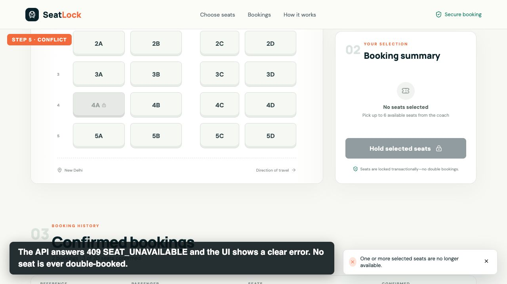
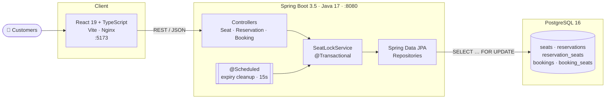
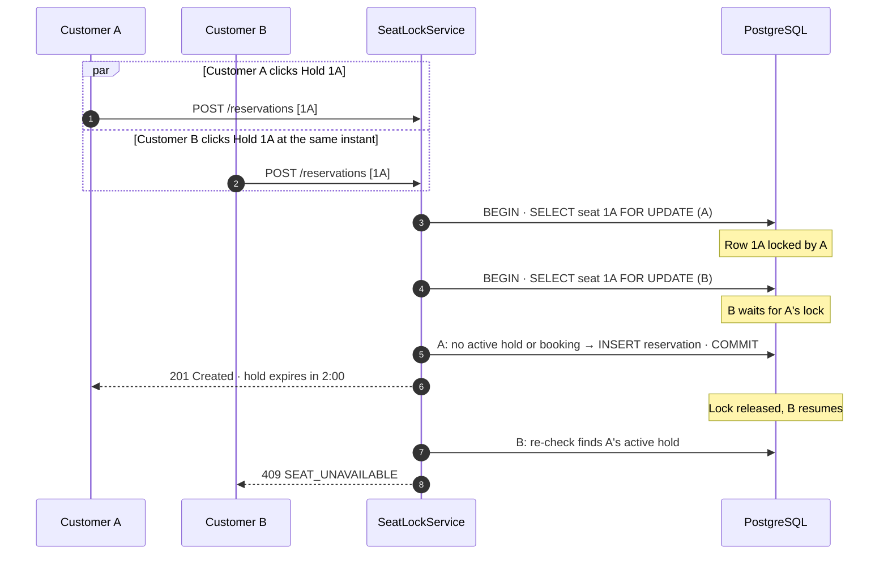
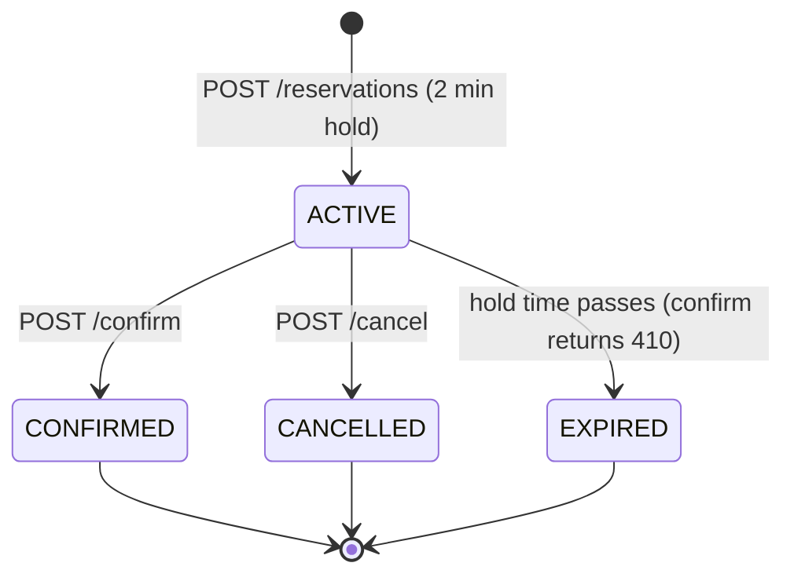
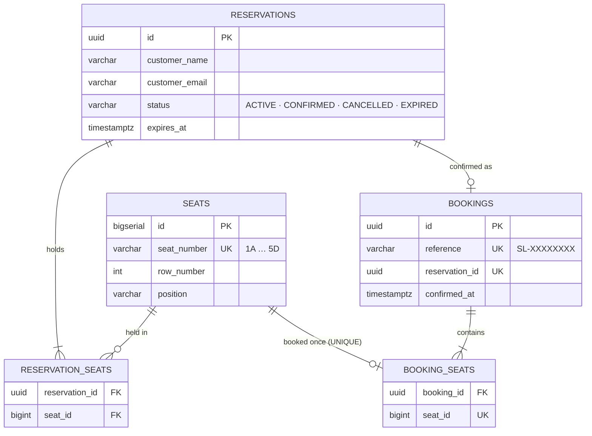
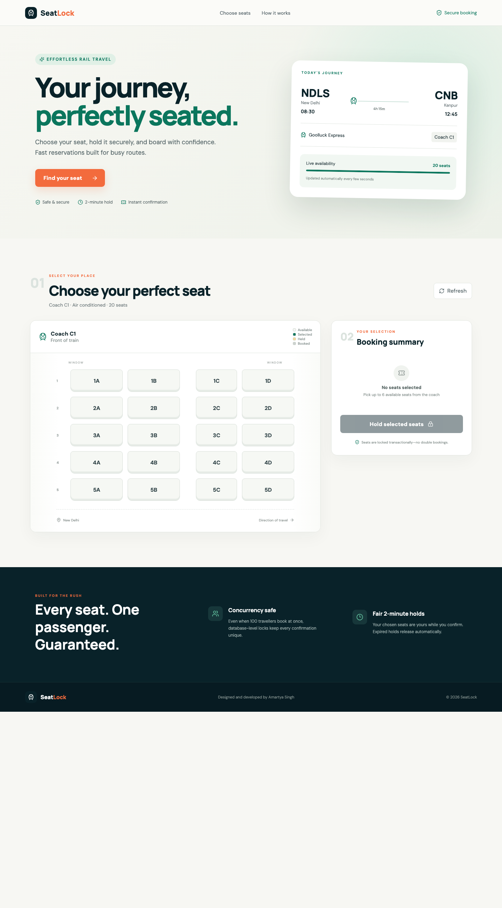

<div align="center">

# 🚆 SeatLock

### Concurrent Train Seat Booking System

**20 seats. 100 simultaneous customers. Zero double bookings.**

[](https://seatlock-web-nb7o.onrender.com)
[](https://seatlock-api-jjb4.onrender.com/swagger-ui.html)
[](docs/demo/seatlock-demo.mp4)


[Live demo](#-live-demo) · [Video](#-demo-video) · [Quick start](#-quick-start) · [Concurrency design](#-how-double-bookings-are-prevented) · [API](#-rest-api) · [Testing](#-testing-and-proof) · [Requirements](#-assignment-requirements-coverage)

</div>

---

## 📌 Overview

SeatLock is a full-stack train seat reservation system built for one hard problem: **staying correct under contention**. One coach has 20 seats, and up to 100 customers may try to book at the same instant. Customers hold seats for two minutes, then confirm with a simulated payment, cancel, or let the hold expire. Every rule is enforced by PostgreSQL transactions, row locks, and constraints, not by the UI.

<table>
<tr>
<td align="center"><h3>20</h3>seats in coach C1</td>
<td align="center"><h3>100</h3>concurrent customers tested</td>
<td align="center"><h3>2 min</h3>transactional seat hold</td>
<td align="center"><h3>0</h3>duplicate bookings</td>
</tr>
</table>

## 🌐 Live demo

| Resource | URL |
|---|---|
| 🖥️ Application | **https://seatlock-web-nb7o.onrender.com** |
| 🔌 REST API | https://seatlock-api-jjb4.onrender.com/api/v1/seats |
| 📖 Swagger UI | https://seatlock-api-jjb4.onrender.com/swagger-ui.html |
| ❤️ Health | https://seatlock-api-jjb4.onrender.com/actuator/health |

> [!NOTE]
> The API runs on Render's free tier and sleeps when idle. The first request after a quiet period can take up to a minute while it wakes up.

## 🎬 Demo video

[](docs/demo/seatlock-demo.mp4)

<div align="center">

**▶ [Watch the 1:49 subtitled walkthrough](docs/demo/seatlock-demo.mp4)** · captions also available as [`seatlock-demo.srt`](docs/demo/seatlock-demo.srt)

</div>

| Time | What the video shows |
|---|---|
| 0:00 | Live seat map loaded from the backend |
| 0:16 | **Select and lock** seats 1A and 1B with a countdown timer |
| 0:23 | **Confirm** with simulated payment; the seats turn Booked |
| 0:32 | **Cancel** a hold on 2A; the seat is released immediately |
| 0:42 | **Expiry**: a hold on 3A runs out and the seat becomes Available |
| 1:10 | **Conflict**: another customer takes 4A first and the UI shows `409 SEAT_UNAVAILABLE` |
| 1:19 | **100 simultaneous customers** with a script; zero duplicates in the database |
| 1:32 | All 20 seats Booked, each listed exactly once in booking history |

The hold was shortened to 20 seconds for the recording (`LOCK_DURATION=PT20S`) so expiry fits on camera. The default is two minutes.

## ✨ Features

| Area | What you get |
|---|---|
| **Seat map** | One 20-seat coach (rows 1–5, seats A–D) with Available, Selected, Held and Booked states, refreshed every 8 seconds |
| **Temporary locking** | Up to 6 seats held for 2 minutes in a single transaction, with a live countdown and progress bar |
| **Confirmation** | Simulated payment creates a durable booking with a unique reference such as `SL-4A21F93B` |
| **Release** | Cancelling frees seats instantly; expired holds count as available on every read and write path |
| **Concurrency** | Pessimistic row locks, ordered locking, re-checks inside the lock, and database `UNIQUE` constraints |
| **Clear errors** | Stable JSON errors (`400`, `404`, `409`, `410`) shown in the UI as readable messages |
| **Booking history** | Confirmed bookings listed in the UI and served by `GET /api/v1/bookings` |
| **Developer experience** | Flyway migrations, Swagger UI, Postman collection, Docker Compose, Makefile, integration tests, load script |

## 🏗️ Architecture



The backend follows the required **Controller → Service → Repository** layering. Controllers stay thin. `SeatLockService` owns every transaction boundary. Repositories expose the locking queries.

<details>
<summary><b>📁 Project structure</b></summary>

```text
SeatLock/
├── backend/                              Java 17 · Spring Boot · JPA · Flyway
│   └── src/main/java/com/amartya/seatlock/
│       ├── api/                          REST controllers and DTOs
│       ├── service/SeatLockService.java  Transactions, locking, business rules
│       ├── repository/                   JPA repositories with lock queries
│       ├── domain/                       Seat, Reservation, Booking entities
│       ├── exception/                    Error model and global handler
│       └── config/                       CORS and OpenAPI
│   └── src/main/resources/db/migration/  Flyway schema and seat seed
├── frontend/                             React 19 · TypeScript · Vite · Nginx
├── scripts/concurrency-demo.mjs          100-customer live load test
├── docs/                                 Postman collection, screenshots, demo video
├── docker-compose.yml                    Database + API + client
├── render.yaml                           Render deployment Blueprint
└── Makefile                              up · down · test · demo · reset
```

</details>

## 🔒 How double bookings are prevented

This is the core of the assignment, so the guarantees are layered: if any one layer were bypassed, the next would still stop a duplicate.



| # | Safeguard | Where | Why it matters |
|---|---|---|---|
| 1 | **Short atomic transactions** | `SeatLockService` (`@Transactional`) | Hold, confirm and cancel either fully succeed or fully roll back |
| 2 | **Pessimistic row locks** | `SeatRepository.findAllBySeatNumberInForUpdate` (`PESSIMISTIC_WRITE`) | Competing requests for the same seat are serialized by PostgreSQL |
| 3 | **Deterministic lock order** | Seat numbers sorted before locking (`ORDER BY seat_number`) | Multi-seat holds always lock in the same order, preventing deadlocks |
| 4 | **Checks inside the lock** | Active holds and bookings queried *after* the rows are locked | The waiting transaction sees the winner's committed data, never a stale read |
| 5 | **Locked confirmation** | Reservation row re-locked, then its seats, on confirm | An expired or already-confirmed hold can never become a booking |
| 6 | **Database invariant** | `booking_seats.seat_id UNIQUE`, `bookings.reservation_id UNIQUE` | Even an application bug cannot store a seat in two bookings |

```java
// SeatRepository.java: every write path starts by locking the requested seat rows
@Lock(LockModeType.PESSIMISTIC_WRITE)
@Query("select s from Seat s where s.seatNumber in :numbers order by s.seatNumber")
List<Seat> findAllBySeatNumberInForUpdate(@Param("numbers") List<String> numbers);
```

> [!IMPORTANT]
> **Invariant:** a seat may appear in at most one confirmed booking. With 20 seats, 100 competing requests can therefore never confirm more than 20 seats. The integration test and the live load script both check this.

**Why pessimistic rather than optimistic locking?** Contention is the expected case here, not the exception. Optimistic locking would make 80 of 100 customers fail and retry, while row locks queue them briefly and return a clear, deterministic `409`.

### Reservation lifecycle



Expiry never depends on the scheduler: every query treats a hold whose `expires_at` has passed as free. The `@Scheduled` job only marks old rows `EXPIRED` for housekeeping.

### Database schema



The full schema and the seed for 20 seats are in [`V1__create_booking_schema.sql`](backend/src/main/resources/db/migration/V1__create_booking_schema.sql), applied automatically by Flyway.

## 🚀 Quick start

### Option 1: Docker (recommended)

**Prerequisites:** Docker Desktop with Compose v2, and ports `5173`, `8080` and `55432` free.

```bash
git clone https://github.com/amartya1523/SeatLock-Concurrent-Train-Seat-Booking-System.git
cd SeatLock-Concurrent-Train-Seat-Booking-System
docker compose up --build
```

| Service | URL |
|---|---|
| Application | http://localhost:5173 |
| Swagger UI | http://localhost:8080/swagger-ui.html |
| Health check | http://localhost:8080/actuator/health |

Stop with `docker compose down`. Add `-v` to erase booking data. To shorten holds for a demo, start with `LOCK_DURATION=PT20S docker compose up --build`.

### Option 2: Run each service yourself

**Prerequisites:** Java 17+, Node.js 20+, and Docker or PostgreSQL 14+.

```bash
# Terminal 1: database
docker compose up -d database

# Terminal 2: API (the Maven wrapper downloads Maven automatically)
cd backend
DB_URL=jdbc:postgresql://localhost:55432/seatlock ./mvnw spring-boot:run

# Terminal 3: client
cd frontend
npm install
npm run dev
```

Flyway creates the schema and seeds seats `1A` through `5D` on first start.

### Makefile shortcuts

| Command | Action |
|---|---|
| `make up` / `make down` | Start or stop the full Docker stack |
| `make test` | Backend tests, frontend lint and build |
| `make demo` | Run the 100-customer concurrency script |
| `make reset` | Recreate the database volume for a fresh demo |

## 🔌 REST API

Base URL: `http://localhost:8080/api/v1` locally, or `https://seatlock-api-jjb4.onrender.com/api/v1` live.

| Method | Endpoint | Purpose | Success |
|---|---|---|---|
| `GET` | `/seats` | Live status of all 20 seats | `200` |
| `POST` | `/reservations` | Hold up to 6 seats for two minutes | `201` |
| `POST` | `/reservations/{id}/confirm` | Simulated payment; creates the booking | `200` |
| `POST` | `/reservations/{id}/cancel` | Cancel an active hold and release its seats | `200` |
| `GET` | `/bookings` | Confirmed booking history | `200` |

<details open>
<summary><b>Example: hold seats</b></summary>

```bash
curl -X POST http://localhost:8080/api/v1/reservations \
  -H 'Content-Type: application/json' \
  -d '{
    "customerName": "Amartya Singh",
    "customerEmail": "amartya@example.com",
    "seatNumbers": ["1A", "1B"]
  }'
```

```json
{
  "reservationId": "2a74a31c-48c6-4e72-8532-3ccb4bf16888",
  "status": "ACTIVE",
  "seatNumbers": ["1A", "1B"],
  "expiresAt": "2026-11-02T09:00:00Z",
  "remainingSeconds": 119
}
```

</details>

<details>
<summary><b>Example: confirm a reservation</b></summary>

```bash
curl -X POST http://localhost:8080/api/v1/reservations/2a74a31c-48c6-4e72-8532-3ccb4bf16888/confirm
```

```json
{
  "bookingId": "8f1c2d7e-5b7a-4f0e-9a51-0c6f3c2e1d44",
  "reference": "SL-4A21F93B",
  "customerName": "Amartya Singh",
  "customerEmail": "amartya@example.com",
  "seatNumbers": ["1A", "1B"],
  "confirmedAt": "2026-11-02T08:59:02Z"
}
```

</details>

### Error responses

Every error uses the same JSON shape:

```json
{
  "timestamp": "2026-11-02T08:58:14Z",
  "status": 409,
  "code": "SEAT_UNAVAILABLE",
  "message": "One or more selected seats are no longer available."
}
```

| Status | Code | When |
|---|---|---|
| `400` | `VALIDATION_FAILED` | Missing name, invalid email, unknown seat format, or more than 6 seats |
| `400` | `DUPLICATE_SEAT` | The same seat appears twice in one request |
| `404` | `SEAT_NOT_FOUND` / `RESERVATION_NOT_FOUND` | Unknown seat or reservation ID |
| `409` | `SEAT_UNAVAILABLE` | Seat is already held or booked by someone else |
| `409` | `ALREADY_CONFIRMED` / `RESERVATION_NOT_ACTIVE` | Confirming twice, or cancelling a finished reservation |
| `410` | `RESERVATION_EXPIRED` | Confirming after the two-minute hold has passed |

📮 **Postman:** import [`docs/SeatLock.postman_collection.json`](docs/SeatLock.postman_collection.json). It covers the full flow, including a request that demonstrates the `409` conflict. Generated OpenAPI JSON is at `/v3/api-docs`.

## 🧪 Testing and proof

```bash
cd backend && ./mvnw test           # needs Docker for Testcontainers
cd frontend && npm run lint && npm run build
```

The backend integration tests start a real, isolated PostgreSQL 16 container. There are no mocks for the concurrency logic.

| Test | What it proves |
|---|---|
| `ConcurrentBookingIntegrationTest` | 100 threads released by a latch at the same instant produce exactly **20** confirmations and **20** unique seats |
| `ReservationLifecycleIntegrationTest` | Cancelling releases seats; an expired hold releases its seat, is rejected with `410`, and is stored as `EXPIRED` |
| `SeatConflictIntegrationTest` | Held and booked seats return `409 SEAT_UNAVAILABLE`; a reservation cannot be confirmed twice |

### Live load test against the running API

```bash
node scripts/concurrency-demo.mjs        # or: make demo (Node.js 18+, no dependencies)
```

Each of 100 customers holds one seat and immediately confirms it, with five customers competing for every seat. On a fresh database:

```text
"outcomes": { "CONFIRMED": 20, "SEAT_UNAVAILABLE": 80 },
"confirmedThisRun": 20,
"uniqueSeatsThisRun": 20,
"totalBookedSeats": 20,
"duplicateSeatsInDatabase": 0

PASS: no seat was booked twice and at most 20 seats are confirmed.
```

Running it a second time confirms nothing (`SEAT_UNAVAILABLE: 100`), because every seat is already taken. Reset with `make reset`.

## ✅ Assignment requirements coverage

| Requirement | Status | How it is met |
|---|:---:|---|
| **A. Seat selection:** 20-seat coach showing Available / Locked / Booked from the backend | ✅ | `GET /seats` drives the seat map; held and booked seats cannot be selected |
| **B. Temporary locking:** 2-minute lock, countdown, confirm or cancel, release on expiry or cancel, reject expired confirmations | ✅ | Transactional holds, live countdown, `410 RESERVATION_EXPIRED` |
| **C. Booking confirmation:** simulated payment, seats persisted as Booked, no seat booked twice | ✅ | `bookings` and `booking_seats` tables with a `UNIQUE(seat_id)` constraint |
| **D. Concurrency:** simultaneous requests, never more than 20 seats, clear unavailable response, consistent database | ✅ | Row locks, ordered locking, re-checks inside the lock, DB constraints, 100-thread test |
| **Tech stack:** React, Java 17+ Spring Boot, PostgreSQL, Spring Data JPA, Controller–Service–Repository | ✅ | React 19, Spring Boot 3.5, PostgreSQL 16, Hibernate, layered packages |
| **Local demo:** all six demonstration steps | ✅ | See the [demo video](#-demo-video) and the checklist below |
| **Submission:** source, README, schema, API docs or Postman, screenshots or video, concurrency explanation | ✅ | This README, Flyway migration, Swagger and Postman, video, screenshot |
| **Bonus:** public deployment | ✅ | Render (static site, Docker API, PostgreSQL) |
| **Bonus:** Docker and Docker Compose | ✅ | `docker compose up --build` |
| **Bonus:** automated tests for expiry and concurrency | ✅ | Three Testcontainers integration test classes |
| **Bonus:** booking history | ✅ | History table in the UI and `GET /bookings` |
| **Bonus:** improved responsive UI/UX | ✅ | Mobile-friendly layout, toasts, countdown bar, seat legend |
| **Bonus:** authentication and user accounts | ➖ | Left out on purpose to focus on correctness; see design decisions |

### Live demonstration checklist

| Step | How to show it |
|---|---|
| 1. Select and lock a seat | Pick seats, enter name and email, click **Hold selected seats**; the countdown starts |
| 2. Confirm and show updated status | Click **Confirm & pay**; the seat turns Booked and appears in booking history |
| 3. Cancel or let a lock expire | Click **Cancel reservation**, or wait for the countdown; the seat returns to Available |
| 4. Book a locked or booked seat | Hold a seat in one window, try the same seat in a second window (or Postman's **Hold an already held seat**) to get `409` |
| 5. Simulate simultaneous requests | `make demo`, or run `ConcurrentBookingIntegrationTest` |
| 6. Verify 20 seats and no duplicates | The script's `PASS` summary, the all-Booked seat map, and `GET /bookings` |

## 🖼️ Interface



## ⚙️ Configuration

| Variable | Default | Description |
|---|---|---|
| `DB_URL` | `jdbc:postgresql://localhost:5432/seatlock` | JDBC connection URL |
| `DB_USERNAME` / `DB_PASSWORD` | `seatlock` / `seatlock` | Local database credentials |
| `DB_POOL_SIZE` | `20` | HikariCP connection pool size |
| `SERVER_PORT` | `8080` | API port |
| `ALLOWED_ORIGIN` | `http://localhost:5173` | Allowed CORS origin |
| `LOCK_DURATION` | `PT2M` | Hold duration in ISO-8601 format |
| `VITE_API_URL` | `http://localhost:8080/api/v1` | API base URL used by the client |

Checked-in credentials are local development defaults only. No production secrets or API keys are stored in this repository; Render injects production database credentials at runtime.

## ☁️ Deployment

The root-level [`render.yaml`](render.yaml) Blueprint describes the public stack:

- **seatlock-web**: the React build served as a static site on Render's CDN
- **seatlock-api**: the Spring Boot API built from [`backend/Dockerfile`](backend/Dockerfile), with health checks on `/actuator/health`
- **PostgreSQL**: an existing Render database, with SeatLock isolated in its own `seatlock` schema
- **Cross-service wiring**: the client learns the API host and the API allows the client origin, both injected by Render

To deploy your own copy, create a new Blueprint in the Render Dashboard, select this repository, and change the `fromDatabase.name` entries to your PostgreSQL instance.

## 🧭 Design decisions and trade-offs

| Decision | Reasoning |
|---|---|
| **Pessimistic locking** over optimistic | Under heavy contention, serializing per seat gives predictable latency and clean `409` responses instead of retry storms |
| **Database as the source of truth** | Locks and `UNIQUE` constraints live in PostgreSQL, so correctness holds across multiple API instances |
| **Absolute expiry timestamps (UTC)** | The client derives its countdown from `expiresAt`, so clock drift and page reloads never extend a hold |
| **Request-time expiry checks** | Expired holds are free immediately; the scheduler is housekeeping only |
| **Polling over WebSockets** | 8-second polling keeps the client simple; the server re-validates on every hold, so stale UI can't cause a double booking |
| **Anonymous checkout** | Authentication is outside the core concurrency problem; reservations already carry customer details and can take user IDs later |

**Possible next steps:** user accounts with JWT, server-sent events for instant seat updates, multiple coaches and journeys, and an admin dashboard.

## 👤 Author

Designed and developed by **[Amartya Singh](https://github.com/amartya1523)** for the Goolluck Consulting LLP Full Stack Developer Intern technical assignment.

> **AI usage disclosure:** generative AI development tools assisted with parts of this project. The architecture, implementation decisions, testing, verification and final review were done by the author, who understands and can explain every part of the implementation.
